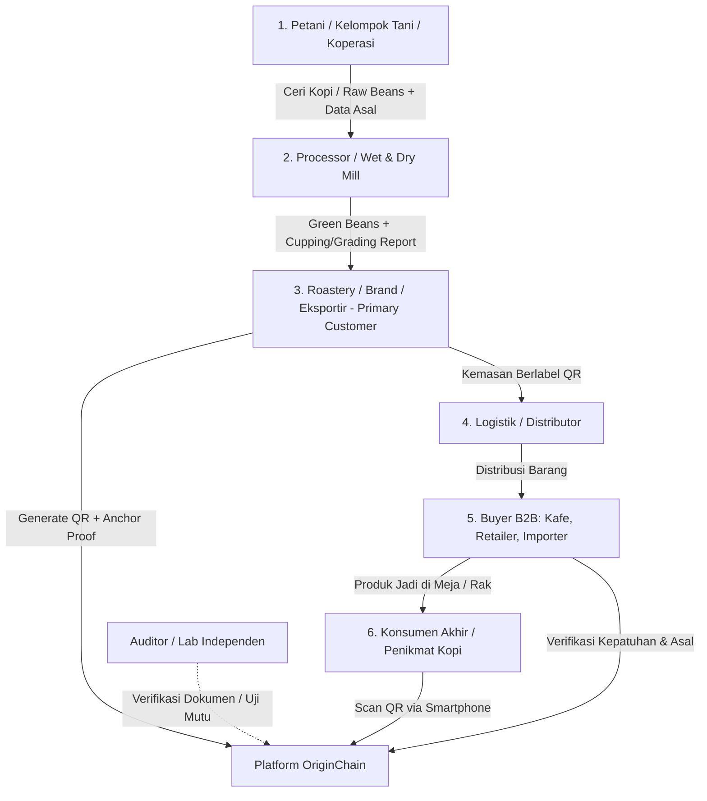
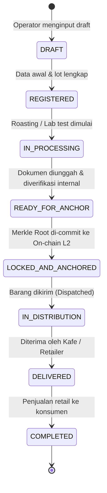
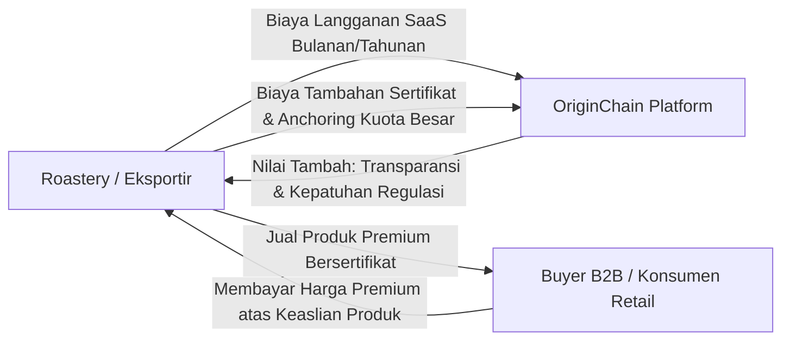

# ORIGINCHAIN — PROSES BISNIS END-TO-END
## Web3 Supply Chain Traceability Platform

Dokumen ini mendefinisikan seluruh proses bisnis terperinci untuk **OriginChain**, mencakup peran stakeholder, alur kerja dari hulu ke hilir (*farm to cup*), state machine siklus hidup batch, mekanisme verifikasi & kepercayaan (*trust model*), dan model aliran finansial (*monetization*).

---

## 1. Stakeholder & Peran dalam Ekosistem

### Rincian Peran & Tanggung Jawab:

1. **Petani / Koperasi (Origin / Hulu)**
   * **Aktivitas**: Memanen komoditas, mencatat lokasi kebun (elevasi, koordinat GPS/desa), varietas bibit, dan tanggal panen.
   * **Data Input**: Tanggal panen, estimasi berat, varietas (misal: Bourbon, Typica, Kartika), elevasi kebun (mdpl).
   * **Insentif**: Memperoleh harga jual lebih tinggi (*fair price / premium price*) karena transparansi asal komoditasnya.

2. **Processor / Pengolah Bahan Baku (Mid-stream)**
   * **Aktivitas**: Memproses ceri menjadi *green beans* (Metode: Washed, Natural, Honey, Anaerobic), pengukuran kadar air (*moisture content* 10–12%), dan sortasi ukuran/cacat (*defect grading*).
   * **Data Input**: Metode pasca-panen, tanggal selesai penjemuran, kadar air, grading fisik, nomor lot pengolahan.

3. **Roastery / Brand / Eksportir (The Primary Customer / Economic Buyer)**
   * **Aktivitas**: Membeli *green beans*, melakukan uji rasa (*cupping* standar SCA oleh Q-Grader), penyangraian (*roasting profile*), pengemasan, pembuatan batch di OriginChain, dan penempelan QR code.
   * **Status di Sistem**: Pemilik organisasi (*Tenant Admin*) yang berlangganan OriginChain dan mengendalikan data komersial batch.
   * **Data Input**: Tanggal sangrai, cupping score (misal: 86.25), *flavor notes* (misal: Citrus, Jasmine, Honey), nomor batch komersial, upload dokumen (invoice, sertifikat, lab report).

4. **Logistik / Distributor (Transporter)**
   * **Aktivitas**: Menangani pengiriman karung goni (*green beans*) atau kemasan retail (*roasted beans*), memperbarui status checkpoint serah terima.

5. **Buyer B2B (Kafe Mitra, Retailer, Eksportir/Importer Luar Negeri)**
   * **Aktivitas**: Memindai QR code sebelum menerima kiriman atau menandatangani kontrak untuk memvalidasi:
     - Keaslian varietas dan asal wilayah.
     - Kepatuhan dokumen regulasi (seperti uji pestisida, sertifikasi organik, kepatuhan EUDR bebas deforestasi).

6. **Konsumen Akhir (End-Consumer)**
   * **Aktivitas**: Memindai QR code pada kemasan retail (pouch 200g / 1kg) menggunakan kamera smartphone standar **tanpa perlu login, tanpa aplikasi khusus, dan tanpa crypto wallet**.
   * **Output**: Melihat *landing page* interaktif dengan cerita petani, transparansi rantai pasok, profil rasa, dan bukti verifikasi dokumen.

---

## 2. Alur Kerja Operasional End-to-End (5 Tahapan)

### Tahap 1: Inisiasi Bahan Baku (Raw Material Logging)
1. Koperasi atau Roastery membuat catatan **Lot Bahan Baku** di dashboard OriginChain.
2. Form mencakup:
   - Identitas Petani / Koperasi Pengumpul.
   - Wilayah Kebun (Kecamatan, Kabupaten, Elevasi, Koordinat/Poligon).
   - Varietas dan Tanggal Panen.
3. Status Lot: `REGISTERED`.

### Tahap 2: Pengolahan, Kurasi Mutu, dan Upload Dokumen
1. Processor/Roastery memasukkan data pasca-panen:
   - Proses: Natural / Fully Washed / Honey / Anaerobic Slow Dry.
   - Uji Laboratorium / Cupping: Skor SCA, penilai (Q-Grader), catatan rasa.
2. Unggah Dokumen Bukti Pendukung:
   - File sertifikat (PDF/Gambar), hasil lab, atau foto bukti kebun.
3. **Kalkulasi Kriptografis Otomatis**:
   - Sistem secara otomatis menghitung nilai **SHA-256 Hash** dari setiap file yang diunggah.
   - Hash ini disimpan di database sebagai *fingerprint* permanen dokumen.

### Tahap 3: Pembuatan Batch & Pengikatan Kriptografis (Batch Anchoring)
1. Roastery menggabungkan Lot Bahan Baku + Profil Roasting menjadi **Batch Komersial**.
2. Sistem menerbitkan:
   - **Batch Short ID** unik (misal: `OC-GY24-8891`).
   - **QR Code Publik** dengan URL tetap: `https://originchain.id/b/OC-GY24-8891`.
3. Pengikatan Bukti (*Anchoring Queue*):
   - Kumpulan hash batch dimasukkan ke dalam antrean *Merkle Tree*.
   - Pada jadwal anchoring (harian atau saat batch di-lock), Root Hash Merkle Tree dikirimkan ke Smart Contract di jaringan L2 (Base / Polygon) dengan biaya fraksi sen.
   - Transaksi menghasilkan *TxHash* publik yang dapat diverifikasi siapa saja.

### Tahap 4: Pelabelan Fisik & Pengemasan
1. Roastery mengunduh label QR Code resolusi tinggi (SVG/PNG) langsung dari dashboard.
2. Label dicetak dan ditempelkan pada:
   - Kemasan retail (*roasted beans pouch*), ATAU
   - Tag karung goni (*green beans jute bag*) untuk pengiriman B2B.
3. Ketika batch dikirimkan, roaster/distributor memperbarui status menjadi `SHIPPED`.

### Tahap 5: Transparansi Publik, Konsumsi, dan Verifikasi Independen
1. Pembeli / Konsumen memindai QR code dengan smartphone.
2. Halaman publik memuat dalam waktu < 1.5 detik:
   - **Header**: Nama produk, origin (misal: "Gayo Pantan Musara"), batch number, roast date.
   - **Verification Badge**:
     * 🟡 `Self-Declared`: Data klaim roastery/petani.
     * 🟢 `Document-Backed`: Dilengkapi dokumen dengan SHA-256 fingerprint yang cocok.
     * 🔵 `Audited`: Terverifikasi oleh auditor/lab pihak ketiga.
   - **Origin Story & Profil Rasa**: Catatan rasa, ketinggian kebun, profil petani.
   - **Timeline Rantai Pasok**: Jejak kronologis dari panen hingga kemasan.
   - **Tombol Cek Bukti Kriptografis**: Memungkinkan pengguna teknis/auditor melihat Merkle Proof dan L2 TxHash di blockchain explorer.

---

## 3. State Machine Siklus Hidup Batch

* **Aturan Penguncian Data**: Setelah status mencapai `LOCKED_AND_ANCHORED`, atribut esensial (origin, varietas, tanggal panen, skor cupping, hash dokumen) **tidak dapat diedit lagi** untuk mencegah manipulasi data. Setiap catatan tambahan (seperti checkpoint logistik) hanya dapat ditambahkan secara *append-only* di audit trail.

---

## 4. Mekanisme Trust & Penanganan Risiko Lapangan

| Risiko Lapangan | Konsekuensi | Solusi & Mitigasi OriginChain |
| :--- | :--- | :--- |
| **Garbage In, Garbage Out (GIGO)** | Data palsu diinput sejak awal ke dalam sistem. | Sistem secara transparan menampilkan status verifikasi (`Self-Declared` vs `Document-Backed`). Brand mempertaruhkan reputasinya secara publik jika klaim palsu terbukti bohong. |
| **Duplikasi QR Code (Fotokopi Label)** | Label QR disalin dan ditempel ke karung/kemasan kopi murahan. | **Scan Anomaly Engine**: Sistem mencatat frekuensi scan dan geolokasi agregat. Jika 1 QR di-scan di dua kota berjauhan dalam rentang waktu beberapa menit, sistem memberi peringatan fraud flag. Di fase lanjut, dapat menggunakan segel anti-rusak (*tamper-evident seals*). |
| **Konektivitas Rendah di Kebun** | Petani/koperasi tidak memiliki sinyal internet stabil. | Desain form input mendukung mode *Offline-First* (disimpan di browser local storage) dan otomatis tersinkronisasi saat perangkat mendapatkan sinyal. |

---

## 5. Model Bisnis & Aliran Finansial (Revenue Model)

### Siapa yang Membayar?
* **Pelanggan Utama (B2B)**: Roastery Kopi, Koperasi Pengolah, dan Perusahaan Eksportir.
* **Konsumen Akhir**: Bebas biaya (100% gratis memindai QR dan melihat data).

### Paket Langganan SaaS:
1. **Tier Starter (Artisan Roasters)**:
   * Rp 350.000 – Rp 500.000 / bulan.
   * Kuota: Hingga 30 batch aktif / bulan.
   * Fitur: Batch management, QR generator, halaman publik mobile, upload dokumen dengan SHA-256 hashing.
2. **Tier Growth (Koperasi & Roastery Menengah)**:
   * Rp 1.500.000 – Rp 2.500.000 / bulan.
   * Kuota: Hingga 200 batch aktif / bulan.
   * Fitur: Custom branding di halaman publik (logo roastery), tim multi-user, scheduled Merkle L2 blockchain anchoring, PDF batch report export.
3. **Tier Enterprise (Eksportir & Pabrik Skala Besar)**:
   * Custom Enterprise Pricing (Rp 7.500.000+ / bulan).
   * Fitur: Kuota batch tak terbatas, modul kepatuhan EUDR (poligon geolokasi kebun), integrasi API dengan ERP internal, SLA dukungan teknis dedicated.
